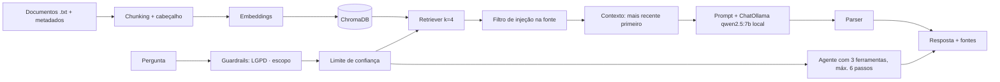

# Aurora Circular — GS2026.2 CitizenTech (Frente B: Descarte e sustentabilidade)

Assistente fictício da Prefeitura de Santa Aurora que responde, com fonte e avaliação medida, onde descartar óleo de cozinha usado e se o ponto está funcionando.
Disciplina: Prompt and Artificial Intelligence · Turma 1CCPH · Prof. Jorge Luiz Gomes.
Integrantes: Thiago Calazans Luz Nakano (RM 569151) · Leticia Aiko Okano (RM 571988).

## Pipeline

Fluxo: documento → chunk → índice → retriever → prompt → LLM → guardrail → resposta.

## Base documental e a armadilha
- `doc_01_regulamento` (2026-02-10), `doc_02_pontos_coleta` (2026-11-10) e `doc_03_comunicado_interdicao` (2026-11-13), escritos pelo grupo (ambiente fictício).
- **Armadilha:** regulamento e cadastro dizem que a Praça das Flores funciona; o comunicado mais recente (13/11) a declara interditada, com reabertura prevista (não garantida) para 21/11. Responder certo exige escolher o documento mais recente.
- **Detalhe escondido:** limite de 5 litros por semana por morador no Parque das Águas, só na seção "Condições específicas" do cadastro.

## Decisões técnicas
- Chunking: **[PREENCHER: estratégia escolhida]**, comparada a outras 2 com teste de preservação de contexto (notebook, seção 1). Cabeçalho `[doc_id | título | data]` em cada chunk.
- Retriever: k=4; similaridade por cosseno; embeddings `paraphrase-multilingual-MiniLM-L12-v2`.
- LLM: `qwen2.5:7b` via **Ollama local no Colab (GPU T4)**, sem API paga e sem chave. Pipeline em LCEL.
- Por que local: a conta do Ollama Cloud retornou erro 402 (sem créditos) durante o desenvolvimento; usamos o Ollama local, alternativa prevista no briefing para juiz local.
- Agente: tools `consultar_status_ponto` (erro controlado para ponto inexistente), `calcular_volume_total` (cálculo) e `buscar_na_base`; `max_iterations=6`.
- Guardrails: escopo, injeção na fonte, LGPD (dados pessoais) e limite de confiança (score mínimo de relevância).

## Limitações
- Base fictícia e pequena (3 documentos): os resultados do RAGAS não representam um município real.
- O status dos pontos usado pelo agente (`PONTOS`) é um espelho dos documentos `doc_02` e `doc_03`; em produção viria de um banco atualizado pela Secretaria.
- O filtro de escopo é por palavras-chave (frágil) e o filtro de injeção na fonte remove linhas por padrões conhecidos.
- Juiz do RAGAS e gerador são o mesmo modelo pequeno e local (`qwen2.5:7b`): métricas instáveis; tratar como comparativo.
- Não há histórico persistente entre sessões nem monitoramento em produção.

## Custo aproximado
- RAG: 1 chamada ao LLM por pergunta + 1 busca vetorial (mais 1 busca para o limite de confiança na interface).
- Agente: de 1 a 6 chamadas ao LLM por pergunta (limite `max_iterations=6`), mais as ferramentas.
- Avaliação RAGAS: 8 respostas + dezenas de chamadas ao juiz (várias por pergunta e por métrica); é a etapa mais lenta e a que mais pesa em cota.

## Como rodar
1. Abra o notebook no Google Colab e ative a GPU (`Runtime → Alterar tipo de ambiente de execução → T4 GPU`). Não é preciso chave de API.
2. `Runtime → Run all`. A primeira execução instala o Ollama e baixa o modelo (alguns minutos). A interface Gradio abre com link público.
